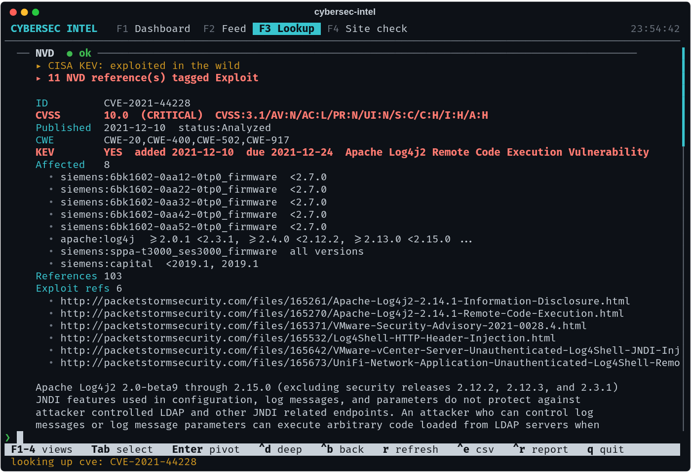

# cybersec-intel


Single-file terminal threat intel: feeds, indicator lookups, passive site check, CVE → exploit search. Free API tiers only. Passive: it never connects to the target.



## Install

```bash
git clone https://github.com/hunt3r-1/cybersec-intel.git
cd cybersec-intel
./install.sh          # creates .env (600) and a launcher in ~/.local/bin
```

Needs Python 3.9+ and a Linux terminal. No `pip install`. Without the installer: `cp .env.example .env && python3 intel.py`.

Optional, for local exploit search: `exploitdb`, `metasploit-framework`, `nuclei` templates.

## Use

```bash
cybersec-intel                                   # interactive screen
cybersec-intel --lookup 8.8.8.8                  # IP, domain, URL, hash, CVE, GHSA, PYSEC
cybersec-intel --lookup example.org --deep       # plus VirusTotal relations / sandbox, AbuseIPDB /24
cybersec-intel --prescan http://example.org/x    # site verdict, score 0–100
cybersec-intel --poc CVE-2021-44228              # GitHub PoCs, Exploit-DB, Metasploit, Nuclei
cybersec-intel --feed                            # threat feed
cybersec-intel --file targets.txt                # bulk lookup
cybersec-intel --prescan-file sites.txt          # bulk site check
```

Add `--json` or `--csv PATH` to any of them. Piped output is plain text. Exit code `2` for a rejected indicator. Private addresses are never sent to an API.

## Keys (interactive)

| Key | Action |
|---|---|
| `F1`–`F4` | dashboard, feed, lookup, site check |
| `Enter` | look up the typed indicator |
| `Tab`, then `Enter` | select a row and pivot to it |
| `Ctrl+B` | back |
| `Ctrl+D` | deep mode |
| `r` | refresh |
| `Ctrl+E` / `Ctrl+R` | export CSV / save Markdown report to `exports/` |
| `q` | quit |

## API keys

All optional, all free tier. Put them in `.env`; a missing key only disables that source.

| Variable | Service |
|---|---|
| `VT_API_KEY` | VirusTotal |
| `ABUSEIPDB_API_KEY` | AbuseIPDB |
| `OTX_API_KEY` | AlienVault OTX |
| `NVD_API_KEY` | NVD |
| `SHODAN_API_KEY` | Shodan |
| `URLHAUS_AUTH_KEY` | abuse.ch (URLhaus, ThreatFox, MalwareBazaar) |
| `MYTHREATINTEL_TOKEN` | MyThreatIntel |

Keyless, always on: Shodan InternetDB and CVEDB, CIRCL, OSV, EPSS, RDAP, crt.sh, PoC-in-GitHub.

## Notes

- Site check verdicts: 60+ malicious, 30–59 suspicious, 8–29 weak signals.
- Daily quotas and rate limits are enforced, and answers are cached (30 min – 24 h), so repeats cost nothing.
- Shodan free plan refuses some IPs ("Requires membership"); NVD and crt.sh can be slow or time out.
- For contributors and AI agents: [AGENTS.md](AGENTS.md). Release notes: [CHANGELOG.md](CHANGELOG.md).

## License

MIT — see [LICENSE](LICENSE). Use only on systems and investigations you are authorized to work on.
